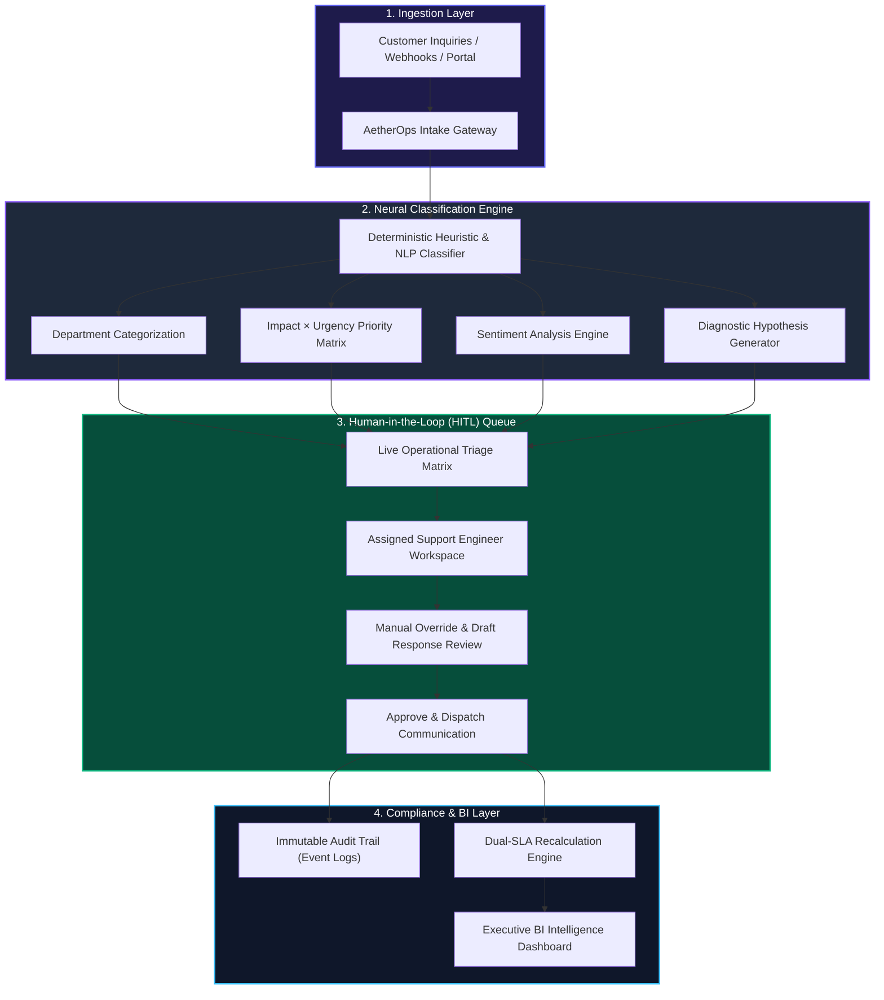

# AetherOps

> **Enterprise AI Operations & Autonomous Triage Intelligence Hub**  
> *Architected for ITIL Dual-SLA Compliance, Human-in-the-Loop AI Governance, and Operational Business Intelligence.*

[](https://react.dev/)
[-3178C6?logo=typescript&logoColor=white)](https://www.typescriptlang.org/)
[](https://vitejs.dev/)
[](https://tailwindcss.com/)
[](LICENSE)

---

## 1. Executive Summary & Business Problem

In enterprise operations and customer support organizations, manual ticket triage represents a multi-million-dollar operational bottleneck. Across global enterprises, customer inquiries spanning billing discrepancies, critical infrastructure outages, account lockouts, and regulatory requests typically sit in unrouted queues for an average of **4 to 8 hours** before reaching the appropriate engineering or finance team.

### The Quantifiable Business Cost
* **SLA Breach Penalties:** Enterprise Service Level Agreements (SLAs) frequently carry contractual financial penalties for delayed response or prolonged downtime.
* **Customer Churn Risk:** Unresolved critical incidents in high-tier accounts (ARR > $100k) directly accelerate account churn.
* **Operational Labor Overhead:** Senior support engineers and managers lose 20–35% of their weekly capacity manually categorizing, tagging, and assigning support tickets.

**AetherOps** solves this crisis by combining **automated AI classification** with **strict human-in-the-loop oversight**, reducing triage latency from hours to seconds while enforcing ITIL compliance and preserving auditability.

---

## 2. System Architecture & Data Flow



---

## 3. Core Architectural Pillars

### A. Human-in-the-Loop (HITL) AI Governance
Rather than relying on unmonitored "black-box" automation, AetherOps enforces enterprise AI safety standards:
* **Advisory AI Generation:** The AI produces a **Diagnostic Hypothesis** and a draft resolution response.
* **Agent Empowerment:** Human agents review, edit, and approve communication before dispatch.
* **One-Click Override:** Support engineers can manually reclassify departments or reprioritize incidents on the fly.

### B. ITIL Dual-SLA Compliance Engine
Adhering to IT Service Management (ITSM) standards, the system separates service commitments into two discrete metrics:
1. **First-Response SLA:** Strict 1-hour threshold measuring elapsed time until verified human agent acknowledgment.
2. **Resolution SLA:** 8 to 24-hour thresholds measuring total turnaround time to permanent issue resolution.
* **Breach Isolation:** Live countdown timers shift from Green (`ok`) to Amber (`approaching`) to Crimson (`breached`), with a dedicated 1-click filter isolating non-compliant tickets.

### C. Enterprise Account & Contract Intelligence
Support requests are directly correlated with corporate financial metrics:
* **Annual Contract Value (ARR):** Automatically mapped across Enterprise ($180k/yr), Growth ($48k/yr), and Startup ($12k/yr) tiers.
* **Dynamic Churn Risk Flagging:** Automatically computes retention risk based on customer contract tier and incident severity.

### D. Immutable Audit Trail (Regulatory Compliance)
Every ticket maintains a chronological, tamper-proof activity ledger recording:
* Ticket ingestion timestamp and routing source.
* AI confidence scoring and initial categorization.
* Manual agent overrides and status transitions.
* Response approvals and communication history (SOX/ISO compliance).

### E. Executive Business Intelligence & Reporting
* **Departmental Volume Distribution:** Visualizing operational workload across Billing, Infrastructure, Account Access, and Security.
* **Evidence-Grounded Recommendations:** Management suggestions citing specific empirical data (e.g., correlating payment webhook delays to 42% of critical SLA warnings).
* **1-Click CSV Export:** RFC-compliant spreadsheet data export for corporate reporting.

---

## 4. UI/UX Design System: Apple VisionOS Liquid Frosted Glass

The user interface was engineered to deliver an ultra-premium, tactile digital experience inspired by Apple VisionOS and macOS Sequoia:

* **Dark Mode (Deep Obsidian):** `#07080B` void with ambient radial mesh glows and electric indigo illumination.
* **Light Mode (Liquid Crystal Glass):** Translucent frosted glass (`rgba(255,255,255,0.72)`) with `backdrop-filter: blur(28px)`, prismatic edge rim light (`inset 0 1px 1px rgba(255,255,255,0.95)`), and airy pastel iridescent ambient lighting.
* **Ambient Cursor Spotlight:** A soft 540px luminous spotlight that follows the user's cursor, softly illuminating frosted glass cards upon hover.
* **Futuristic Startup Sequence:** High-tech VisionOS bootloader with an illuminated pulsing emblem and real-time initialization diagnostics.

---

## 5. Technology Stack

| Layer | Technologies | Purpose |
| :--- | :--- | :--- |
| **Frontend Framework** | **React 19** | Declarative component hierarchy, modern hooks |
| **Language** | **TypeScript 5.6 (Strict)** | Strict compile-time typesafety across all data models |
| **Build & Tooling** | **Vite 6** | Instant Hot Module Replacement (HMR) and optimized rollup bundle |
| **Styling** | **Tailwind CSS v4** | Modern utility-first CSS with custom glassmorphism extensions |
| **Icons** | **Lucide React** | Clean, consistent vector iconography |
| **State Machine** | **React Context & Custom Hooks** | Reactive asynchronous service contracts simulating full enterprise persistence |

---

## 6. Project Structure

```text
aetherops/
├── index.html                   # HTML entry point with system fonts
├── package.json                 # Dependency manifests & build scripts
├── tsconfig.json                # Strict TypeScript configuration
├── vite.config.ts               # Vite bundler plugins & aliases
├── src/
│   ├── main.tsx                 # Application mounting
│   ├── App.tsx                  # Root provider & component tree
│   ├── types.ts                 # Strongly-typed enterprise interfaces
│   ├── index.css                # Glassmorphism, animations & theme tokens
│   ├── context/
│   │   └── AppContext.tsx       # Global state machine & action handlers
│   ├── data/
│   │   └── seedTickets.ts       # 12 high-stakes enterprise test incidents
│   ├── utils/
│   │   ├── aiEngine.ts          # NLP heuristics & response generator
│   │   └── slaEngine.ts         # Dual-SLA calculations & BI aggregators
│   └── components/
│       ├── AmbientCursorGlow.tsx# Dynamic pointer spotlight tracking
│       ├── LoadingScreen.tsx    # Futuristic VisionOS boot sequence
│       ├── Dashboard.tsx        # Shell layout, header & theme/role controls
│       ├── KpiIslands.tsx       # Executive metric cards & sentiment bar
│       ├── TriageMatrix.tsx     # Operational queue, filters, CSV & breach controls
│       ├── TicketDrawer.tsx     # Flyout detail, HITL actions & audit log
│       ├── BIView.tsx           # Departmental volume & strategic recommendations
│       └── IngestModal.tsx      # Interactive ticket creation & AI triage simulation
```

---

## 7. Local Development Quickstart

### Prerequisites
* **Node.js** (v18.0 or higher recommended)
* **npm** or **pnpm**

### Installation & Execution
```bash
# 1. Clone the repository
git clone https://github.com/your-username/aetherops.git

# 2. Navigate to project directory
cd aetherops

# 3. Install dependencies
npm install

# 4. Start local development server
npm run dev
```

Open your browser at `http://localhost:5173`.

### Production Build
```bash
# Verify TypeScript types and generate production bundle
npm run build

# Preview production build locally
npm run preview
```

---

## 8. Deployment Guide (Vercel / Netlify)

AetherOps is engineered with a client-side reactive state engine, making it deployable anywhere with zero monthly server costs:

### Deploy to Vercel in 2 Minutes:
1. Push this repository to your GitHub account.
2. Sign in to [Vercel](https://vercel.com/) with GitHub.
3. Click **"Add New Project"** and select `aetherops`.
4. Leave default settings (Framework: **Vite**, Build Command: `npm run build`, Output Directory: `dist`).
5. Click **"Deploy"**. Your live production URL will be ready in under 60 seconds!

---

## 9. Interview Talking Points for Recruiters & Hiring Teams

When demonstrating AetherOps in an interview for **Business Analyst, Systems Analyst, or Technology Consulting** positions, use this framework:

> *"As a Business Information Systems student, I recognized that ticket triage is one of the most expensive and error-prone operational bottlenecks in enterprise IT. 
>
> In designing AetherOps, I implemented core ITIL service management standards:
> 1. I separated **First-Response SLA from Resolution SLA** to enforce distinct compliance thresholds.
> 2. I applied **Human-in-the-Loop AI governance**, ensuring that AI acts strictly as an advisory copilot with mandatory agent review before customer dispatch.
> 3. I engineered an immutable **Audit Trail** for compliance and SOX governance.
> 4. And I connected customer incident priority directly to corporate financial risk (ARR and retention probability), demonstrating how technical support decisions protect enterprise revenue."*

---

## 10. License
This project is licensed under the MIT License — see the [LICENSE](LICENSE) file for details.
